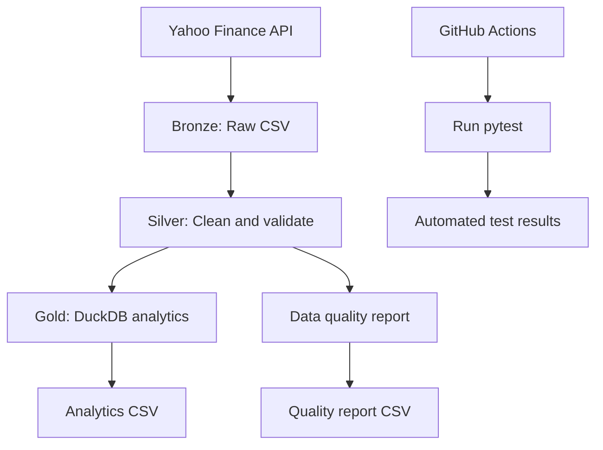

# Data Engineering Platform

A Python-based data engineering pipeline that ingests historical stock market data, validates and transforms it through Bronze, Silver, and Gold layers, and generates a data quality report.

## Architecture



## Features

- Ingests historical stock market data using Python and `yfinance`.
- Stores raw data in a Bronze layer.
- Cleans and validates data in a Silver layer using pandas.
- Removes missing values, duplicate records, and invalid price or volume records.
- Uses DuckDB and SQL window functions to calculate:
  - Daily price changes
  - Daily percentage returns
  - 20-day moving averages
  - 20-day rolling volatility
- Generates a CSV data quality report.
- Includes automated tests with pytest.
- Uses structured logging to help monitor pipeline execution.
- Runs automated tests through GitHub Actions on pushes and pull requests to `main`.

## Technology Stack

- Python
- pandas
- DuckDB and SQL
- yfinance
- pytest
- Git and GitHub Actions

## Project Structure

```text
data-engineering-platform/
├── data/
│   ├── bronze/
│   ├── silver/
│   └── gold/
├── src/
│   ├── ingestion/
│   │   └── extract.py
│   ├── transformation/
│   │   ├── transform.py
│   │   ├── gold.py
│   │   └── quality_report.py
│   └── pipeline.py
├── tests/
│   └── test_pipeline.py
├── .github/
│   └── workflows/
│       └── tests.yml
├── requirements.txt
└── README.md
```

## Getting Started

### 1. Clone the repository

```bash
git clone https://github.com/moa23/Data-engineering-platform.git
cd Data-engineering-platform
```

### 2. Create a virtual environment

```bash
python3 -m venv .venv
source .venv/bin/activate
```

### 3. Install dependencies

```bash
python -m pip install -r requirements.txt
```

### 4. Run the pipeline

```bash
python -m src.pipeline
```

The pipeline downloads data, creates the Silver and Gold datasets, and generates a quality report.

### 5. Run the tests

```bash
python -m pytest -v
```

## Data Quality

The quality report checks:

- Total number of rows
- Missing required values
- Duplicate ticker/date records
- Invalid price and volume records

The report is saved to `data/gold/data_quality_report.csv`.

## Current Scope

This project currently uses CSV files for storage and runs locally. It is designed as a foundation for further development in orchestration, cloud storage, and scalable data processing.
